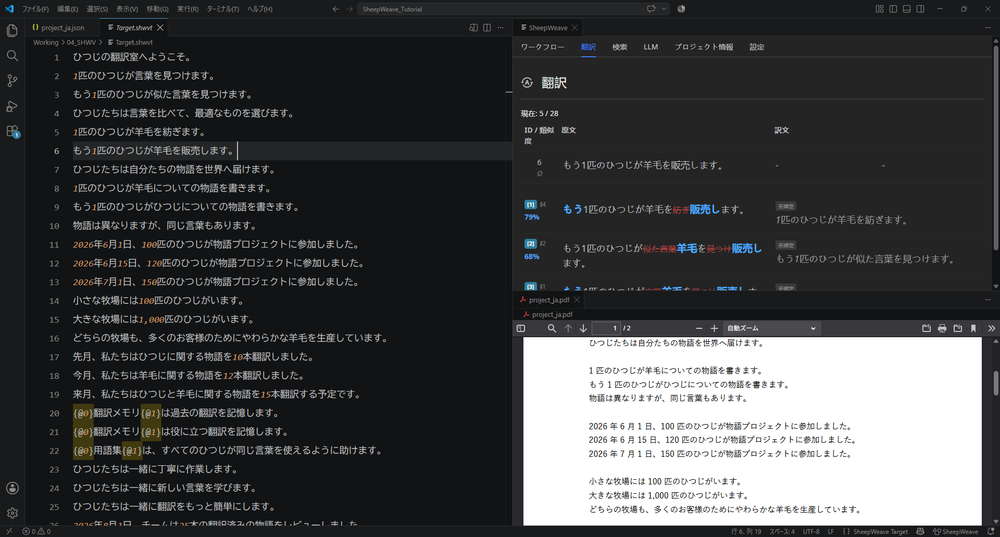

# SheepWeave

VS Code 拡張機能で実現する翻訳支援ツール（CAT ツール）です。

コンセプトは **機織り（Weave）**。

翻訳の糸を紡ぎ、美しい布を織り上げます。

## 主な機能

- **翻訳メモリ・用語集の活用**: 翻訳メモリとの類似や含まれる用語など、CAT ツールとしての基本機能をサポート
- **強力な置換＆補完**: プレーンテキストベースなので置換が高速。さらに AI による補完とも高相性
- **ローカル処理**: 解析から翻訳までローカルで完結。VS Code 環境さえあれば、どこでも軽量に実行可能
- **クロスプラットフォーム**: Windows はもちろん、macOS や Linux でも軽快に動作。古いサブ PC のお供にも

## 目次・ドキュメント一覧

<Toc :items="[
  { title: 'はじめに', link: './01_get_started', desc: 'SheepWeave の概要とインストール・初期設定' },
  { title: 'チュートリアル（基本体験編）', link: './02_tutorial', desc: 'サンプルデータを用いた基本的な翻訳操作の体験' },
  { title: '実際のファイルの翻訳', link: './03_actual_translation', desc: '実際の業務ファイルを読み込んで翻訳を進める実践手順' },
  { title: '画面の見方', link: './04_interfaces', desc: 'エディタ画面やステータスバー、各種パネルの役割' },
  { title: 'ショートカットと便利な機能', link: './05_shortcuts_and_functions', desc: '翻訳効率を劇的に向上させるキーボードショートカット' },
  { title: '簡易置換のすすめ', link: './06_simple_replace', desc: '正規表現や一括置換を安全に活用するノウハウ' },
  { title: '継続的な翻訳', link: './07_continuous_translation', desc: '翻訳メモリの蓄積とプロジェクト間の資産活用' },
  { title: 'LLM / AI 連携', link: './08_LLM_usage', desc: 'AI（LLM）と連携した翻訳支援・サジェスト機能' },
  { title: 'その他の機能', link: './09_other_usage', desc: '高度な設定や便利なユーティリティ機能' },
  { title: '多言語 Excel の翻訳と Rainbow の活用', link: './10_rainbow', desc: 'Excel 多言語対訳データの処理と Rainbow ツールの連携' },
  { title: 'CATツールについて', link: './11_about_cat', desc: '翻訳支援ツールの基礎知識と SheepWeave の思想' },
  { title: 'VS Codeの使い方', link: './12_vscode_usage', desc: '翻訳者のための VS Code 基本操作とカスタマイズ' }
]" />
